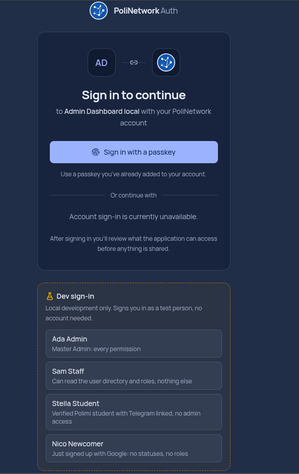

# Login locale di Admin: diagnosi e passaggio di consegne

Il login locale è stato sbloccato con `AGENT_MODE=false`, usando un'istanza locale di PoliNetwork Auth e la
persona **Ada Admin**. Questa PR raccoglie le modifiche ad Admin e documenta la configurazione usata.
**Il setup completo non è automatizzato: applicare la PR e avviare solo Admin non basta.**

## Errori osservati e cause

| Sintomo                                                                                             | Causa individuata                                                                                                                                                                                                        | Intervento                                                                                                        |
| --------------------------------------------------------------------------------------------------- | ------------------------------------------------------------------------------------------------------------------------------------------------------------------------------------------------------------------------ | ----------------------------------------------------------------------------------------------------------------- |
| `Invalid input: expected string, received undefined` per `OIDC_CLIENT_ID` e `SESSION_SECRET`        | Il file locale di Admin aveva `BACKEND_URL` e `AGENT_MODE=false`, ma mancavano le credenziali OIDC e il segreto della sessione. `src/server/auth-config.ts` valida queste variabili quando viene usato il login normale. | Configurato un client nel nuovo IdP e compilato il `.env` locale. Per la preview è disponibile `AGENT_MODE=true`. |
| `The sign-in service is temporarily unavailable` e `OIDC discovery unavailable` in `oidc.server.ts` | Dopo lo stop dei servizi, `IDP_URL` puntava ancora ad Auth su `localhost:3002`, ma Auth era spento.                                                                                                                      | Riavviati il PostgreSQL di Auth e il processo Auth.                                                               |
| Backend: `[REDIS] reconnect retry #...`                                                             | Il Redis del backend su `6379` era spento.                                                                                                                                                                               | Avviato un Redis locale per il backend. Admin usa un secondo Redis su `6380`.                                     |
| Backend: `[IDP] Token authentication is not configured: only legacy anonymous calls are accepted`   | Il backend non aveva la configurazione IdP necessaria per verificare i bearer token di Admin.                                                                                                                            | Configurati issuer, audience e client di servizio per leggere lo snapshot dei permessi.                           |

Il warning Azure sul directory seed in memoria è distinto dal login OIDC: il backend locale non aveva le
credenziali Azure e usava i dati di sviluppo previsti dal codice.

## Modifiche incluse in Admin

| Commit                                                               | Modifica                                                                                                                                                                                                                                     |
| -------------------------------------------------------------------- | -------------------------------------------------------------------------------------------------------------------------------------------------------------------------------------------------------------------------------------------- |
| `d8e12e3` — `fix(auth): support both local preview and OIDC login`   | `/auth/login` e logout gestiscono il caso agent mode prima di leggere la configurazione OIDC. La route `/login` passa `agentMode` alla pagina, che mostra testo e azione adatti alla preview. `.env.example` distingue preview e login OIDC. |
| `ff4d362` — `docs(auth): document full local OIDC setup`             | README con porte, due client OIDC, variabili dei tre servizi e login con Ada Admin.                                                                                                                                                          |
| `2e4c697` — `docs(auth): clarify local service startup dependencies` | README con dipendenze da tenere attive e procedura di riavvio dopo lo stop dello stack.                                                                                                                                                      |

La modifica al codice completa la gestione della preview con agent mode. Il login normale è stato sbloccato
configurando i servizi già esistenti: la validazione delle variabili obbligatorie rimane necessaria.

## Configurazione locale effettuata fuori dalla PR

Repository usati durante la configurazione: Auth a `5a891b33b2c6c4ad3f97174b6e85bc39b3223166` e backend a
`16da07cc61e3b6e673a3084fb1a5648673feedcb`. Non sono state necessarie modifiche al loro codice per questo flusso.

| Servizio        | Indirizzo               | Preparazione effettuata                                                                                                              |
| --------------- | ----------------------- | ------------------------------------------------------------------------------------------------------------------------------------ |
| Backend         | `http://localhost:3000` | Aggiornato il `.env` ignorato da Git con la configurazione IdP e la chiave privata del client di servizio.                           |
| Admin           | `http://localhost:3001` | Aggiornato il `.env` ignorato da Git con `AGENT_MODE=false`, client OIDC, segreto di sessione e Redis dedicato.                      |
| Auth            | `http://localhost:3002` | Clonato `PoliNetworkOrg/auth` accanto agli altri repo; preparato `.env.local`, applicate migrazioni e seed con `pnpm run dev:setup`. |
| PostgreSQL Auth | `localhost:55432`       | Avviato il Compose di Auth; contiene utenti di prova, client OIDC e consensi locali.                                                 |
| Redis backend   | `localhost:6379`        | Container `pn-backend-redis`, immagine `redis:7-alpine`.                                                                             |
| Redis Admin     | `localhost:6380`        | Container separato `pn-admin-redis`, immagine `redis:7-alpine`; conserva le sessioni del BFF.                                        |

Sono state generate credenziali locali e una coppia di chiavi Ed25519. Sono poi stati registrati **due client nel
database locale di Auth con SQL eseguito una tantum**. Questo passaggio ha creato stato nel database; lo script temporaneo
non è incluso nella PR. Il README descrive la registrazione dall'interfaccia `/applications`, ma quel percorso
non è stato verificato dall'inizio alla fine durante la configurazione.

| Client                     | Autenticazione        | Configurazione                                                                                                                                                                                                                                        |
| -------------------------- | --------------------- | ----------------------------------------------------------------------------------------------------------------------------------------------------------------------------------------------------------------------------------------------------- |
| **Admin Dashboard local**  | `client_secret_basic` | Tipo `native` per consentire localhost; callback `http://localhost:3001/auth/callback`; logout `http://localhost:3001/login`; authorization code e refresh, end-session, scope `openid profile email offline_access backend:admin` e risorsa backend. |
| **Backend snapshot local** | `private_key_jwt`     | Client di servizio con scope `idp:access:read` sulla risorsa interna; JWKS pubblico in Auth e JWK privato nel backend.                                                                                                                                |

I due identificatori di risorsa usati sono `https://backend.internal.polinetwork.org` e
`https://auth.polinetwork.org/api/internal`. Sono audience OAuth: non richiedono un servizio HTTP locale a quegli
indirizzi. Le richieste effettive all'IdP vanno a `http://localhost:3002`.

Le variabili rilevanti, senza riportare credenziali, sono:

| File locale       | Variabili                                                                                                                                                                                                                                                                                                                                                                     |
| ----------------- | ----------------------------------------------------------------------------------------------------------------------------------------------------------------------------------------------------------------------------------------------------------------------------------------------------------------------------------------------------------------------------- |
| `admin/.env`      | `AGENT_MODE=false`, `APP_URL=http://localhost:3001`, `IDP_URL=http://localhost:3002`, `OIDC_CLIENT_ID`, `OIDC_CLIENT_SECRET`, `SESSION_SECRET` (almeno 32 caratteri), `BACKEND_URL=http://localhost:3000`, `BACKEND_RESOURCE=https://backend.internal.polinetwork.org`, `REDIS_URL=redis://localhost:6380`. Impostare una sola credenziale client: secret oppure JWK privato. |
| `auth/.env.local` | Base da `.env.local.example`, incluso `DEV_LOGIN=1`; `BETTER_AUTH_URL=http://localhost:3002`, `PORT=3002`, `OAUTH_BACKEND_RESOURCE_URI`, `OAUTH_INTERNAL_RESOURCE_URI`, `OAUTH_BACKEND_CLIENT_ID` uguale al client di servizio del backend.                                                                                                                                   |
| `backend/.env`    | `IDP_PUBLIC_URL=http://localhost:3002`, `OAUTH_BACKEND_RESOURCE_URI`, `OAUTH_INTERNAL_RESOURCE_URI`, `OAUTH_BACKEND_CLIENT_ID`, `OAUTH_BACKEND_PRIVATE_JWK`. Il JSON della chiave è racchiuso tra apici singoli per il parser `.env` di Bun.                                                                                                                                  |

I file locali, i segreti e le registrazioni nel database non sono distribuiti dalla PR. Il Redis di Admin deve
essere separato da quello del backend; il default di sviluppo `6379` richiede quindi un override in questo stack.

## Login proposti da Auth



Lo screenshot è la pagina di **Auth**, raggiunta dopo il redirect da Admin. I quattro pulsanti erano già presenti
nel repo Auth; questa PR non li implementa.

| Persona        | Uso                                                                               |
| -------------- | --------------------------------------------------------------------------------- |
| Ada Admin      | Master Admin con tutti i permessi; usata per verificare l'accesso alla dashboard. |
| Sam Staff      | Lettura utenti e ruoli dell'IdP; non ha l'accesso amministrativo completo.        |
| Stella Student | Studente verificato con Telegram collegato; senza accesso Admin.                  |
| Nico Newcomer  | Utente appena registrato, senza ruoli o stati verificati.                         |

`DEV_LOGIN=1` crea una sessione Auth per una persona di prova e riprende l'autorizzazione OIDC in corso. Admin resta
in `AGENT_MODE=false` e riceve token tramite il suo normale callback. Solo Ada è stata verificata nel flusso completo.

La scritta **Account sign-in is currently unavailable** compare perché Google e PoliNetwork Entra non sono
configurati nell'Auth locale. Per accedere con un account personale occorre configurare uno di questi provider,
registrare il callback locale e assegnare i permessi necessari. I ruoli Socio/Direttivo richiedono verifiche Entra.

Le passkey sono implementate in Auth, ma richiedono una credenziale registrata nell'istanza locale. Quelle del
servizio pubblico non si trasferiscono a localhost. Non è stato verificato il login locale con passkey.

## Verifiche eseguite e limiti

- Verificata la preview Admin con `AGENT_MODE=true` senza configurazione OIDC.
- Verificato via richieste HTTP con cookie e redirect il flusso normale: `/auth/login` → autorizzazione Auth →
  dev login Ada Admin → `/auth/callback` → `/dashboard`, risposta `200` con Ada Admin.
- Verificato nel log backend uno snapshot IdP con `fresh: true` e la presenza di Ada.
- Verificate connessioni TCP backend → Redis `6379` e Admin → Redis `6380`.
- Eseguiti `pnpm check`, `pnpm typecheck`, `pnpm test` e `pnpm build` dopo le modifiche ad Admin.

Queste verifiche non coprono tutte le operazioni della dashboard, gli altri tre profili, l'accesso tramite
Google/Entra, le passkey o l'avvio da un clone pulito con database vuoto. Lo screenshot è stato fornito dall'utente;
la verifica del flusso è stata effettuata via HTTP, senza automazione del browser.

## Avvio e lavoro da completare

Dopo la prima configurazione descritta nel [README](../README.md#local-oidc-across-auth-backend-and-admin), ad ogni
avvio devono essere attivi il PostgreSQL di Auth, Auth, entrambi i Redis, backend e Admin. `pnpm dev` in Admin
avvia solo Admin. Nella sessione di debug Auth e Redis erano stati avviati dall'assistente: questo spiega perché
il login funzionava anche senza un avvio manuale di Auth da parte dell'utente.

Per riavviare il PostgreSQL esistente usare `docker compose up -d --wait` nel repo Auth, poi `pnpm run dev` in Auth.
I due Redis di sviluppo si possono avviare con:

```sh
docker run -d --rm --name pn-backend-redis -p 127.0.0.1:6379:6379 redis:7-alpine
docker run -d --rm --name pn-admin-redis -p 127.0.0.1:6380:6379 redis:7-alpine
```

Eseguire questi comandi quando i rispettivi container non esistono già. Avviare il backend con `bun run dev` e
Admin con `pnpm dev`. Dopo modifiche ai file d'ambiente riavviare i processi interessati. Lo stop precedente ha
conservato il volume PostgreSQL; i Redis creati con `--rm` sono temporanei e la perdita delle sessioni richiede un nuovo login.

Per completare una soluzione riproducibile, il prossimo sviluppatore dovrebbe:

1. Definire dove mantenere il setup dei tre repo e automatizzare migrazioni, seed, creazione dei due client,
   generazione delle credenziali e configurazione locale. Le registrazioni una tantum nel database sono il principale
   passaggio non riproducibile dalla sola PR.
2. Verificare il percorso `/applications` descritto nel README o sostituirlo con un bootstrap supportato e idempotente.
3. Fornire comandi espliciti per avvio e stop dell'intero stack, con diagnosi di IdP e Redis non raggiungibili.
4. Verificare da un clone pulito il login Ada e i dinieghi degli altri profili; mantenere disponibile anche la preview
   con agent mode. Se serve l'account personale, definire una procedura separata per le credenziali Google/Entra e i ruoli.

Le eventuali PR in Auth e backend dipendono da dove verrà implementato quel bootstrap. Per il login verificato qui
è bastato il loro codice esistente con configurazione e stato locali; questa PR è un passaggio di consegne,
non una dichiarazione che l'onboarding completo sia risolto.
